<div align="center">



<picture>
  <source media="(prefers-color-scheme: dark)" srcset="https://readme-typing-svg.demolab.com?font=JetBrains+Mono&weight=600&size=20&duration=3000&pause=1100&color=36E27A&center=true&vCenter=true&width=620&height=46&lines=Programaci%C3%B3n+%2B+electr%C3%B3nica;Arduino+%C2%B7+C%2B%2B+%C2%B7+C%23+%C2%B7+Python;Me+gusta+hacer+juegos+y+cacharros" />
  
</picture>

<a href="https://github.com/TomasMarcos369?tab=repositories"></a>&nbsp;
<a href="https://www.linkedin.com/in/tom%C3%A1s-marcos-1a7107257/"></a>

</div>

### `> whoami`

```text
Tomás Marcos
Programación + electrónica · estudiante
Stack: Arduino / C++ · C# / .NET · Python · Assembler
Lo que más me gusta: armar juegos y proyectos con hardware.
```

### 🕹️ Proyectos importantes

<p align="center">
  <a href="https://github.com/TomasMarcos369/labo-arduino"></a>
  <a href="https://github.com/TomasMarcos369/proyecto-c-"></a>
  <a href="https://github.com/augusto-zimmermann/Pylatro"></a>
  <a href="https://github.com/Mishardo/TP-Assembler"></a>
</p>

<p align="center"><sub>Pylatro y el juego en Assembler son proyectos hechos en equipo · y hay 30+ repos más en mi perfil.</sub></p>

### 🛠️ Herramientas

<p align="center">
  
</p>

<br />

<p align="center">
  <picture>
    <source media="(prefers-color-scheme: dark)" srcset="https://raw.githubusercontent.com/TomasMarcos369/TomasMarcos369/output/snake-dark.svg" />
    <source media="(prefers-color-scheme: light)" srcset="https://raw.githubusercontent.com/TomasMarcos369/TomasMarcos369/output/snake-light.svg" />
    
  </picture>
</p>


